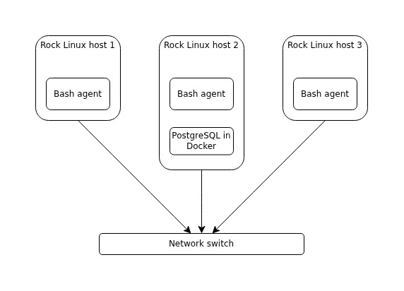

# jarvis_data_eng

## Introduction
This project is used by the
Jarvis Linux Cluster Administration (LCA) team, and the purpose of this project is to record data related to 
a Linux cluster of 10 Rocky Linux servers.
The data includes hardware specifications and resource usage of each node  automatically collected by Crontab and stored in a PostgreSQL database.
The technologies used in this project includes Git, PostgreSQL, Docker, Bash, and Crontab.

## Quick Start
- Start a psql instance using psql_docker.sh
```
# start docker if docker server is not running
sudo systemctl status docker || sudo systemctl start docker

# get latest postgres image
docker pull postgres

# create a new volume if not exist
docker volume create pgdata

# psql docker docs https://hub.docker.com/_/postgres
# set password for default user `postgres`
export PGPASSWORD='password'

# create a container using psql image with name=jrvs-psql
docker run --name jrvs-psql -e POSTGRES_PASSWORD=$PGPASSWORD  -d -v pgdata:/var/lib/postgresql/data -p 5432:5432 postgres:9.6-alpine

# check if the container `jrvs-psql` is created or not
docker container ls -a -f name=jrvs-psql

# make sure the container is running
docker ps -f name=jrvs-psql

# install psql CLI client
sudo dnf install -y postgresql

# set password for default user `postgres`
# doc: https://www.postgresql.org/docs/9.3/libpq-envars.html
export PGPASSWORD='password'

# Connect to psql instance uing psql REPL (read–eval–print loop)
psql -h localhost -U postgres -d postgres -W
```
- Create tables using ddl.sql
```
\c host_agent

CREATE TABLE IF NOT EXISTS PUBLIC.host_info
(
    id               SERIAL NOT NULL,
    hostname         VARCHAR NOT NULL,
    cpu_number       INT2 NOT NULL,
    cpu_architecture VARCHAR NOT NULL,
    cpu_model        VARCHAR NOT NULL,
    cpu_mhz          FLOAT8 NOT NULL,
    l2_cache         INT4 NOT NULL,
    "timestamp"      TIMESTAMP NULL,
    total_mem        INT4 NULL,
    CONSTRAINT host_info_pk PRIMARY KEY (id),
    CONSTRAINT host_info_un UNIQUE (hostname)
);

CREATE TABLE IF NOT EXISTS PUBLIC.host_usage
(
    "timestamp"    TIMESTAMP NOT NULL,
    host_id        INT4 NOT NULL,
    memory_free    INT4 NOT NULL,
    cpu_idle       INT2 NOT NULL,
    cpu_kernel     INT2 NOT NULL,
    disk_io        INT4 NOT NULL,
    disk_available INT4 NOT NULL,
    CONSTRAINT host_usage_host_info_fk FOREIGN KEY (host_id) REFERENCES
        host_info(id)
);
```
- Insert hardware specs data into the DB using host_info.sh
```
psql_host=$1
psql_port=$2
db_name=$3
psql_user=$4
psql_password=$5

if [ "$#" -ne 5 ]; then
    echo "Illegal number of parameters"
    exit 1
fi

# save specs as variables
lscpu_out=`lscpu`
hostname=$(hostname -f)
cpu_number=$(echo "$lscpu_out"  | egrep "^CPU\(s\):" | awk '{print $2}' | xargs)
cpu_architecture=$(echo "$lscpu_out"  | egrep "^Architecture:" | awk '{print $2}' | xargs)
cpu_model=$(echo "$lscpu_out" | grep "^Model name:" | cut -d: -f2 | xargs)
cpu_mhz=$(echo "$lscpu_out" | grep "^Model name:" | cut -d@ -f2 | xargs | awk '{print $1 * 1000}')
l2_cache=$(echo "$lscpu_out" | grep "^L2 cache:" | awk '{print $3}')
total_mem=$(vmstat --unit M | tail -1 | awk '{print $4}')
timestamp=$(date "+%Y-%m-%d %H:%M:%S") # current timestamp in `2019-11-26 14:40:19` format; use `date` cmd

#construct the INSERT statement from specification variables
insert_stmt="INSERT INTO host_info (hostname, cpu_number, cpu_architecture, cpu_model, cpu_mhz, l2_cache, \"timestamp\", total_mem) VALUES ('$hostname', $cpu_number, '$cpu_architecture', '$cpu_model', $cpu_mhz, $l2_cache, '$timestamp', $total_mem);"

# execute the sql command
export PGPASSWORD="$psql_password"
psql -h $psql_host -p $psql_port -d $db_name -U $psql_user -c "$insert_stmt"
```
- Insert hardware usage data into the DB using host_usage.sh
```
# Setup and validate arguments (again, don't copy comments!)
psql_host=$1
psql_port=$2
db_name=$3
psql_user=$4
psql_password=$5

# Check # of args
if [ "$#" -ne 5 ]; then
    echo "Illegal number of parameters"
    exit 1
fi

# Save machine statistics in MB and current machine hostname to variables
vmstat_mb=$(vmstat --unit M)
hostname=$(hostname -f)

# Retrieve hardware specification variables
# xargs is a trick to trim leading and trailing white spaces
memory_free=$(echo "$vmstat_mb" | awk '{print $4}'| tail -n1 | xargs)
cpu_idle=$(vmstat --unit M | tail -1 | awk -v col="15" '{print $col}')
cpu_kernel=$(vmstat --unit M | tail -1 | awk -v col="14" '{print $col}')
disk_io=$(vmstat --unit M -d | tail -1 | awk -v col="10" '{print $col}')
disk_available=$(df -BM / | tail -1 | awk '{print $4}' | tr -d 'M')
timestamp=$(date "+%Y-%m-%d %H:%M:%S") # current timestamp in `2019-11-26 14:40:19` format; use `date` cmd

# Subquery to find matching id in host_info table
host_id="(SELECT id FROM host_info WHERE hostname='$hostname')";

# PSQL command: Inserts server usage data into host_usage table
# Note: be careful with double and single quotes
insert_stmt="INSERT INTO host_usage (\"timestamp\", host_id, memory_free, cpu_idle, cpu_kernel, disk_io, disk_available) VALUES('$timestamp', $host_id, $memory_free, $cpu_idle, $cpu_kernel, $disk_io, $disk_available);"

#set up env var for psql cmd
export PGPASSWORD=$psql_password
#Insert date into a database
psql -h $psql_host -p $psql_port -d $db_name -U $psql_user -c "$insert_stmt"
exit $?
```
- Crontab setup
```
* * * * * /home/rocky/dev/jarvis_data_eng_DelaramMoradi/linux_sql/scripts/host_usage.sh localhost 5432 host_agent postgres password > /tmp/host_usage.log
```


## Implemenation
### Architecture


### Scripts
Shell script description and usage (use markdown code block for script usage)
- `psql_docker.sh`: starts a psql instance
- `host_info.sh`: inserts hardware specifications data into the database
- `host_usage.sh`: inserts hardware usage data into the database
- `crontab`: automatically runs shell scripts

### Database Modeling
**`host_info`**

| Column | Type | Constraints |
|---|---|---|
| `id` | serial integer | Primary key |
| `hostname` | varchar | Not null, unique |
| `cpu_number` | integer | Not null |
| `cpu_architecture` | varchar | Not null |
| `cpu_model` | varchar | Not null |
| `cpu_mhz` | float | Not null |
| `l2_cache` | integer | Not null |
| `timestamp` | timestamp | Not null |
| `total_mem` | integer | Not null |

**`host_usage`**

| Column | Type | Constraints |
|---|---|---|
| `timestamp` | timestamp | Not null |
| `host_id` | integer | Not null, foreign key → `host_info.id` |
| `memory_free` | integer | Not null |
| `cpu_idle` | integer | Not null |
| `cpu_kernel` | integer | Not null |
| `disk_io` | integer | Not null |
| `disk_available` | integer | Not null |

## Test
The bash scripts were tested using the following command, and they run successfully.
```
bash -x [script path] [argument 1] [argument 2] ...
```


## Deployment
Docker provisions the Postgres instance.
Cron runs host_usage.sh every minute on each node.
And the source code is managed through Git and GitHub.

## Improvements
Here are some possible future improvements for the project:
- Writing SQL queries to get insights regarding CPU count and memory
- Writing SQL queries to get insights regarding average memory usage
- Writing SQL queries to get insights regarding host reporting failure
